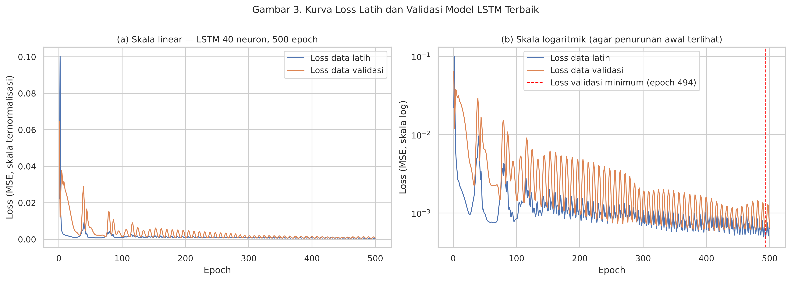

# Perhitungan Manual - Tahap 7.10: Membaca Kurva Loss Model LSTM

[Tahap 7.7 (Pelatihan LSTM Model Utama, Langkah 1-2: Forward Pass dan Loss)](tahap_07_07_pelatihan_lstm_forward_pass_dan_loss.md) sampai [Tahap 7.9 (Pelatihan LSTM Model Utama, Langkah 4: Update Adam)](tahap_07_09_pelatihan_lstm_update_adam.md) menghitung iterasi pertama dan kedua
pelatihan model LSTM utama (40 neuron). Subbagian ini melihat hasil dari
**seluruh** iterasinya (500 epoch) lewat kurva loss latih dan loss validasi.

**Daftar isi**

- [1. Apa yang Digambar Kurva Loss](#1-apa-yang-digambar-kurva-loss)
- [2. Kurva Loss Model LSTM Terbaik](#2-kurva-loss-model-lstm-terbaik)
- [3. Cara Membacanya](#3-cara-membacanya)
- [4. Mengapa Jumlah Epoch Dipilih Lewat Data Validasi](#4-mengapa-jumlah-epoch-dipilih-lewat-data-validasi)
- [5. Hubungan MSE dengan RMSE dalam USD](#5-hubungan-mse-dengan-rmse-dalam-usd)
- [6. Ringkasan: Kapan Loss dan Adam Bekerja](#6-ringkasan-kapan-loss-dan-adam-bekerja)

**Cara membaca angka.** Titik dipakai sebagai pemisah desimal dan koma sebagai pemisah
ribuan. Angka biasanya ditampilkan 6 desimal; angka yang sangat kecil (misalnya gradien)
ditulis dalam notasi ilmiah, contohnya 2.3416e-07 = 0.00000023416. Semua hitungan
dilakukan dengan presisi penuh, jadi kalau Anda menjumlahkan angka yang tampil, selisih
kecil di digit terakhir itu wajar. Nomor persamaan dan gambar mengacu pada draf skripsi
(subbab 1.5.7 sampai 1.5.11).

## 1. Apa yang Digambar Kurva Loss

Di akhir setiap epoch, Keras mencatat dua angka:

- **loss latih**: rata-rata MSE dari 26 batch selama epoch itu
  (25 batch × 32 sampel + 1 batch × 4 sampel). Loss batch
  pertama yang dihitung manual di Tahap 7.7 adalah salah satu penyusun
  loss latih epoch 1;
- **loss validasi**: MSE pada 90 sampel validasi memakai bobot akhir epoch.
  Data validasi **hanya diukur**, tidak dipakai untuk mengubah bobot.

Selama 500 epoch, Adam melakukan 26 × 500 =
**13,000 kali update**, masing-masing persis seperti yang
dihitung di Tahap 7.9.

## 2. Kurva Loss Model LSTM Terbaik



| Besaran | Nilai |
|---|---|
| Loss latih epoch 1 | 0.02209279 |
| Loss latih epoch terakhir (500) | 0.00063068 |
| Penurunan loss latih | 97.1% |
| Loss validasi epoch 1 | 0.06462061 |
| Loss validasi epoch terakhir (500) | 0.00065024 |
| Loss validasi minimum | 0.00059231 (epoch 494) |

## 3. Cara Membacanya

- Kalau **loss latih dan loss validasi turun bersama**, model sedang mempelajari pola yang
  berlaku umum.
- Kalau **loss latih terus turun tetapi loss validasi naik**, itu tanda *overfitting*: model
  mulai menghafal data latih.
- Pada model ini, loss latih turun 97.1% dari epoch pertama, dan loss validasi
  mencapai minimum di epoch 494, dekat sekali dengan epoch terakhir; loss validasi akhir (0.00065024) hampir sama dengan minimumnya.

## 4. Mengapa Jumlah Epoch Dipilih Lewat Data Validasi

RMSE validasi model 40 neuron untuk setiap jumlah epoch pada grid (tabel tuning LSTM):

| Epoch | RMSE validasi (USD) |
|---|---|
| 100 | 3,804.03 |
| 500 | 2,503.99 ← terbaik |
| 1,000 | 2,718.20 |

Pada neuron ini, melatih sampai 1,000 epoch justru memperburuk RMSE validasi dibandingkan 500 epoch. Melatih lebih lama tidak selalu lebih baik; kemungkinan besar model mulai terlalu menyesuaikan diri dengan data latih. Karena itulah jumlah epoch dipilih lewat data validasi, sedangkan data uji tetap netral sampai evaluasi akhir.

## 5. Hubungan MSE dengan RMSE dalam USD

Normalisasi min-max bersifat linear, jadi selisih dalam USD sama dengan selisih
ternormalisasi dikali (x_max − x_min). Akibatnya **RMSE (USD) = (x_max − x_min) × √MSE**.
Dengan rentang harga data latih 123,359.45 − 25,162.70 = 98,196.75:

```
RMSE = 98,196.75 × √0.00065024
     = 98,196.75 × 0.025500
     = 2,503.99 USD
RMSE validasi pada tabel tuning = 2,503.99 USD
```

Jadi **meminimalkan MSE saat pelatihan sama dengan meminimalkan RMSE dalam USD**. Ini jawaban
untuk pertanyaan "kenapa loss-nya MSE tetapi evaluasinya RMSE?".

## 6. Ringkasan: Kapan Loss dan Adam Bekerja

| Tahap penelitian | Loss MSE | Adam |
|---|---|---|
| Model baru dibangun | - | m = 0, v = 0, k = 0 |
| Setiap batch latih (26× per epoch) | dihitung, menjadi sumber gradien | memperbarui semua bobot dan bias |
| Akhir setiap epoch | loss latih dan validasi dicatat (kurva loss) | tidak ada update dari data validasi |
| Pemilihan neuron dan epoch terbaik | tidak (memakai RMSE validasi USD) | tidak |
| Prediksi data uji dan evaluasi | tidak | tidak (bobot sudah beku) |

<!-- navigasi-perhitungan-manual -->

---

← Sebelumnya: [Tahap 7.9: Pelatihan LSTM Model Utama, Langkah 4: Update Adam](tahap_07_09_pelatihan_lstm_update_adam.md)

[Daftar isi perhitungan manual](README.md)

→ Berikutnya: [Tahap 7.11: Forward Pass LSTM (Jendela Pertama Data Uji)](tahap_07_11_forward_pass_lstm.md)
